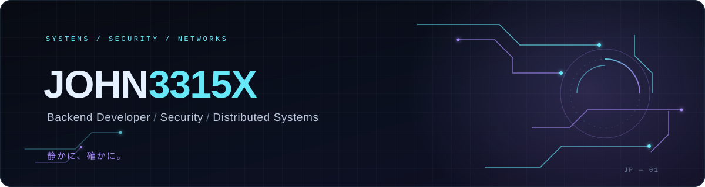

<!--
  JOHN3315X | PROFILE README
  Visual direction: dark minimalism, cyan/violet accents, subtle Japanese detail.
-->

  

 

*Building systems. Exploring security. Understanding complexity.*

---

## `01` — About me

I'm a Business Informatics graduate interested in **backend development, application security, and distributed systems**.

I enjoy understanding how software works beneath the surface: how services communicate, how access is controlled, how networks behave, and how independent entities interact inside a simulated environment.

My projects are a way to explore these ideas through practical implementation, from secure authentication systems and microservices to network monitoring and 2D artificial ecosystems.

- **Focus:** Backend engineering, security, and distributed architectures.
- **Currently exploring:** Java, Spring, Linux, concurrency, and system design.
- **Approach:** Learn by building, testing, breaking things, and improving them.

> 静かに、確かに。
>
> *Quietly, steadily.*

---

## `02` — Featured projects

<table>
<tr>
<td width="50%" valign="top">

### ◈ Zanshin — Zero Trust

A secure authentication platform built around Zero Trust principles and a microservices architecture.

- JWT authentication and role-based access control
- Spring Cloud Gateway
- Redis and PostgreSQL
- Docker and AWS EC2

**Stack:** Java · Spring Boot · Spring Security · JWT · Redis · PostgreSQL

[↗ Explore repository](https://github.com/John3315x/zanshin-zero-trust-system)

</td>
<td width="50%" valign="top">

### ◈ Distributed E-Commerce

An e-commerce system being developed to explore distributed backend architecture and communication between independent services.

Planned areas include:

- Product and inventory management
- Order lifecycle and stock reservations
- Simulated payment processing
- Asynchronous communication with events

**Stack:** Java · Spring Boot · Microservices · PostgreSQL · Docker

*In development — repository coming soon.*

</td>
</tr>
<tr>
<td width="50%" valign="top">

### ◈ Nanakusa MiniSIEM

A Java-based network monitoring and analysis project inspired by Security Information and Event Management systems.

- LAN device discovery
- IP and MAC address identification
- TCP port scanning
- Concurrent monitoring and event collection
- Relational database persistence

**Stack:** Java · JDBC · MySQL/MariaDB · TCP/IP · ExecutorService

[↗ Explore repository](https://github.com/John3315x/Network-Inspector-Java-Core)

</td>
<td width="50%" valign="top">

### ◈ Bacterium — Artificial Ecosystem 2D

A Java simulation exploring autonomous agents and emergent behavior in a two-dimensional artificial ecosystem.

- Autonomous movement and food seeking
- Nutrient consumption and energy management
- Reproduction and energy-based death
- Camera navigation and zoom
- Separation behavior between bacteria

**Stack:** Java 21 · Swing · Java 2D · Maven

[↗ Explore repository](https://github.com/John3315x/Bacteria-Artificial-Ecosystem-2D)

</td>
</tr>
</table>

---

## `03` — Technology stack

### Backend & security

### Databases & messaging

### Infrastructure & DevOps

### Testing & API documentation

### Frontend & networking

---

## `04` — GitHub analytics

---

## `05` — Beyond the code

I also enjoy Japanese language and culture, creative writing, music production, and exploring the intersection between technical systems and emergent behavior.

These interests influence how I approach projects: with curiosity, patience, experimentation, and attention to detail.

---

Designed with curiosity · Built one commit at a time

